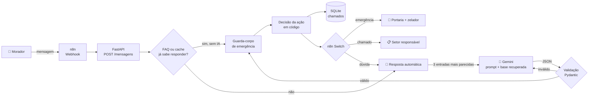
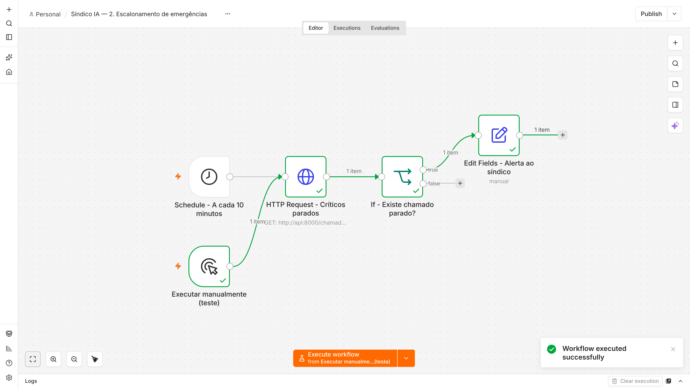
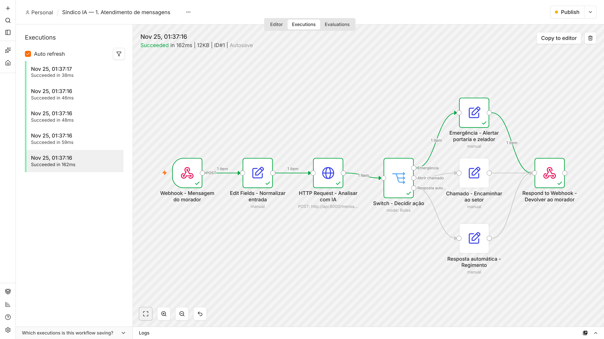
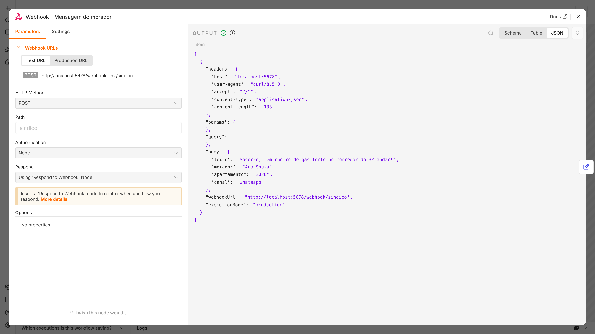
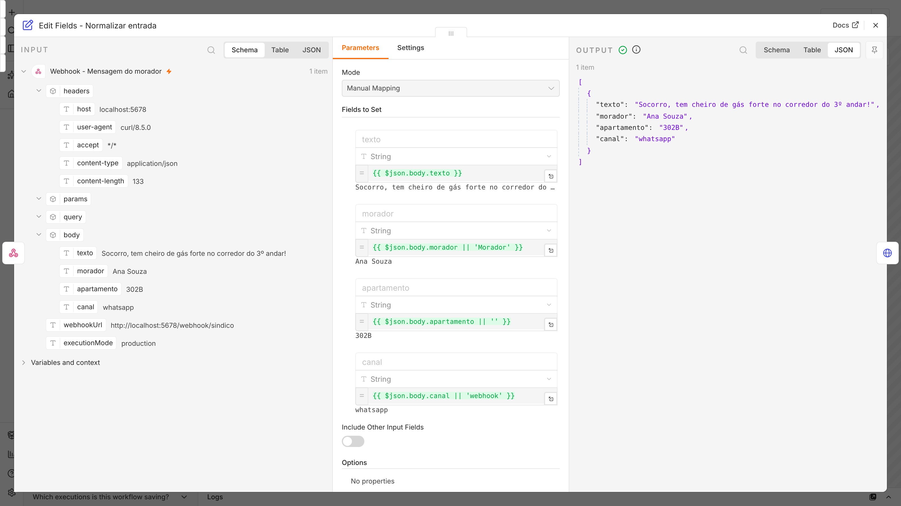
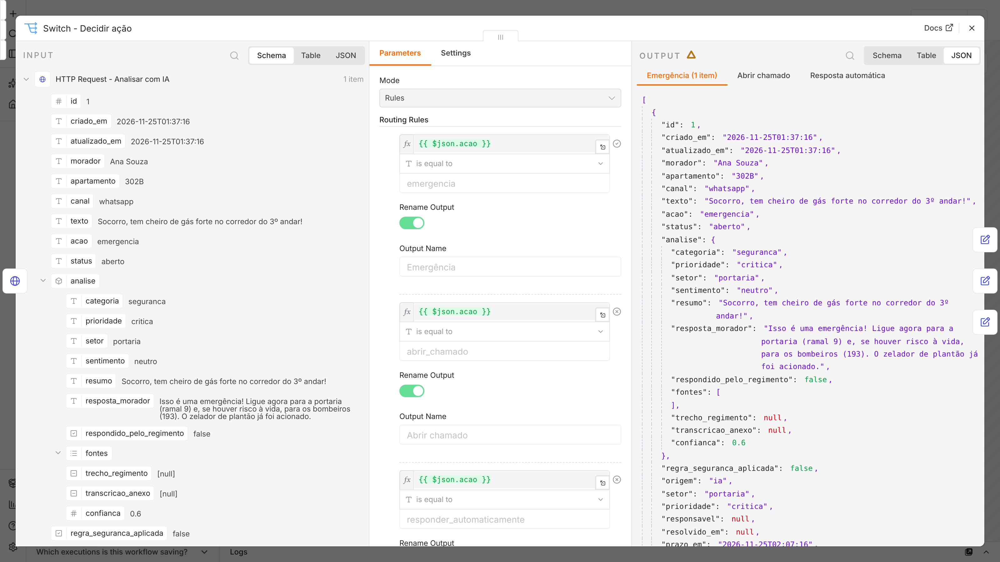
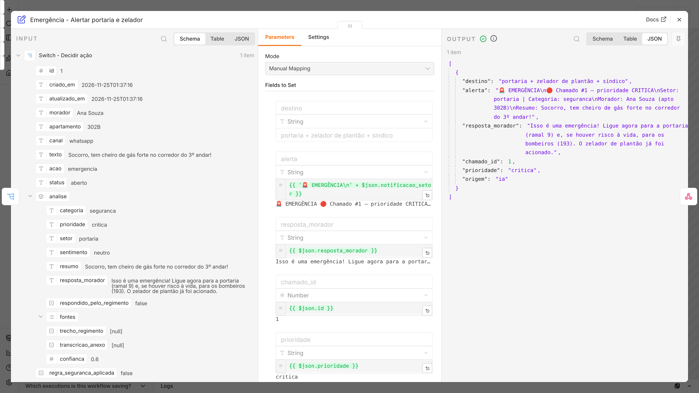
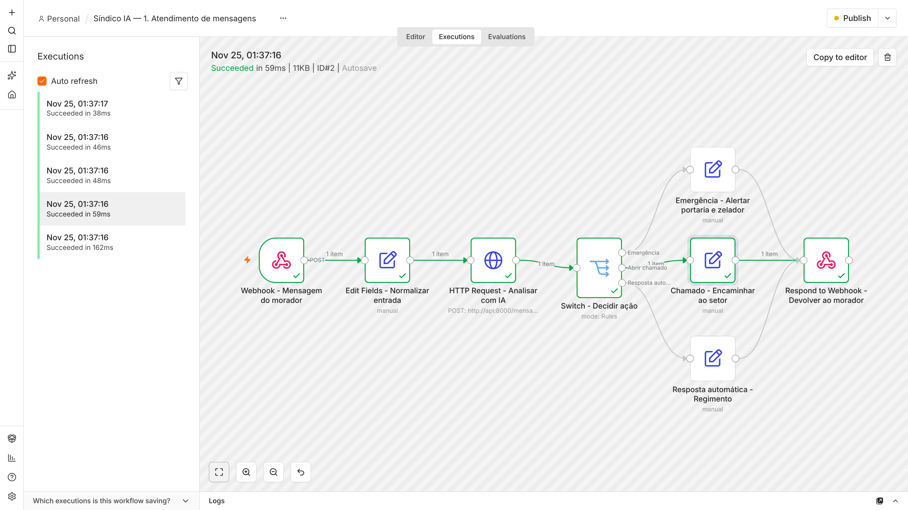
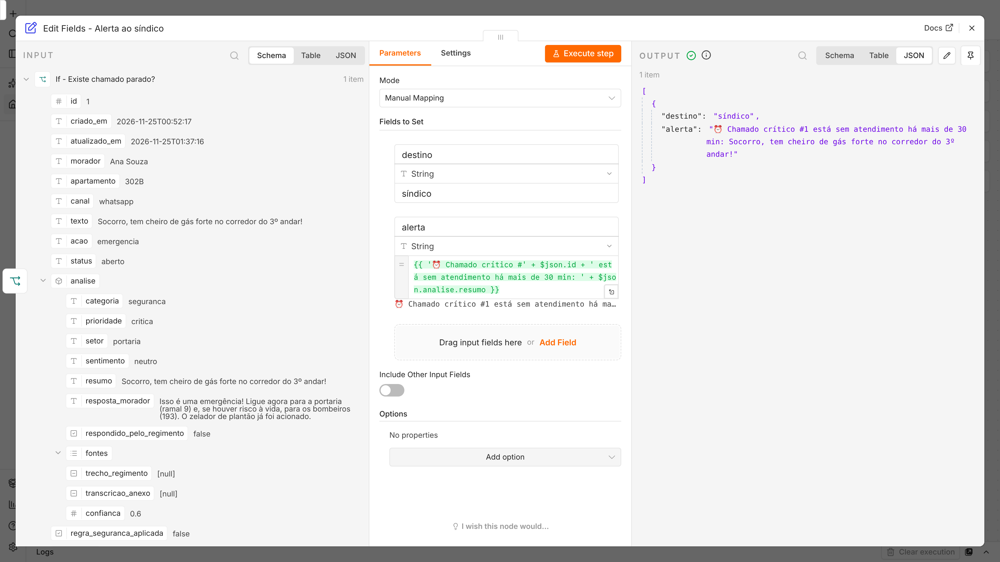

# 🏢 Síndico IA

> Central inteligente de atendimento para condomínios. Ela **entende** a mensagem do morador, **classifica**, **prioriza**, **responde dúvidas consultando o regimento interno**, **escala emergências** e entrega ao síndico um **resumo diário**, tudo com IA, uma API em FastAPI e automação no n8n.

Desafio Técnico KODIE: IA e Automação.

---

## 1. Apresentação da Ideia

<!-- ✏️ Personalize este parágrafo com a sua história -->
Em quase todo condomínio, a comunicação com a administração acontece por grupos de WhatsApp e mensagens soltas para o síndico e o zelador. Avisos urgentes, como um vazamento, se perdem no meio de perguntas repetidas ("a piscina abre segunda?", "posso fazer mudança domingo?"). O síndico, que muitas vezes é um morador voluntário, gasta horas lendo e encaminhando mensagens, e as emergências demoram para chegar a quem pode resolvê-las.

A ideia do **Síndico IA** surgiu dessa realidade: em vez de uma empresa genérica, um cenário concreto em que classificar e priorizar mensagens faz diferença de verdade, inclusive para a segurança dos moradores.

## 2. Problema Escolhido

O projeto tem como base o **caso 4.1 — Classificação de Mensagens** e o amplia com elementos dos outros três casos:

| Caso do desafio | Como aparece no Síndico IA |
|---|---|
| **4.1 Classificação** | Toda mensagem recebe categoria, setor responsável e sentimento |
| **4.3 Organização de tarefas** | Cada mensagem vira um chamado com prioridade (baixa → crítica) e status |
| **4.4 Perguntas frequentes** | Dúvidas respondidas automaticamente com base no **regimento interno** |
| **4.2 Resumo automático** | Todo dia às 18h a IA gera um resumo dos chamados para o síndico |

## 3. Solução Proposta



**Como a IA participa:**
1. **Interpreta** a mensagem em linguagem natural, mesmo informal ("tá saindo água do teto da garagem!!").
2. **Classifica** em categoria, prioridade, setor e sentimento, sempre em **JSON estruturado**.
3. **Responde** dúvidas usando **somente a base de perguntas frequentes** (RAG): só as entradas relacionadas à mensagem vão para o prompt, e a IA precisa citar quais usou.
4. **Resume** os chamados do dia para o síndico.
5. *(Opcional)* **Transcreve áudios e descreve fotos** enviados pelo morador, porque o Gemini é multimodal.

**Decisões de projeto (o que vai além do básico):**
- **A IA interpreta, o código decide.** A ação final (emergência, chamado ou resposta automática) é definida por regras em `app/servico.py`, de forma previsível e testável.
- **Guarda-corpo de segurança.** Se a mensagem contém termos como "cheiro de gás" ou "preso no elevador", a prioridade é forçada para **crítica**, mesmo que a IA erre.
- **Validação com nova tentativa automática.** Todo JSON da IA passa pelo Pydantic. Se vier inválido, o erro é devolvido à IA, que tenta de novo (até 3 vezes).
- **RAG com a base de perguntas frequentes como única fonte.** O `data/faq.json` (17 perguntas, cada uma com variações e o trecho oficial do regimento) é a base de conhecimento. Para cada mensagem:
  1. **Recuperação:** a busca BM25 (`app/rag.py`, local e sem custo) encontra as 3 entradas mais parecidas. Só elas vão para o prompt, não o regimento inteiro.
  2. **Geração:** a IA responde usando apenas essas entradas e devolve em `fontes` quais usou. Se nada se aplica, encaminha para um humano.
  3. **Validação anti-alucinação:** fontes que a IA não recebeu são descartadas. Se ela diz que respondeu mas não cita nenhuma fonte válida, o chamado **não** é encerrado e vai para a equipe. A citação mostrada ao morador vem do texto oficial do FAQ, nunca de algo escrito pela IA.

  Na central, cada chamado mostra o que a IA consultou (com a pontuação da busca) e o que ela usou.
- **Proteção contra prompt injection.** A mensagem do morador vai delimitada por `<mensagem>`, e a IA é instruída a ignorar ordens escritas ali dentro.
- **Economia de IA (FAQ + cache).** Antes de chamar o modelo, a API tenta responder sozinha:
  1. **FAQ local** (`data/faq.json`): as 12 dúvidas mais comuns (piscina, mudança, boleto…) são reconhecidas por palavras-chave e respondidas na hora.
  2. **Cache:** se uma pergunta já foi respondida pela IA nos últimos 7 dias, a mesma resposta é reaproveitada.

  Reclamações ("meu boleto veio **errado**"), mensagens que citam vizinhos, textos longos e **qualquer emergência** sempre vão para a IA. Problemas específicos de um morador (como um vazamento) nunca entram no cache. Cada resposta informa a `origem` (`faq`, `cache` ou `ia`), e `/metricas` mostra quantas chamadas de IA foram economizadas.
- **Resistência a instabilidade.** Se o Gemini estiver sobrecarregado (429/503) ou lento, a API tenta de novo e pode usar modelos reserva (`GEMINI_MODELOS_RESERVA`).
- **Escalonamento.** Um fluxo do n8n verifica a cada 10 minutos se algum chamado crítico está parado há mais de 30 minutos e alerta o síndico.

## 4. Tecnologias Utilizadas

| Camada | Tecnologia |
|---|---|
| IA | **Google Gemini** (API REST, saída em JSON); provedor `mock` para testes offline |
| Back-end | **Python 3.12 + FastAPI** |
| Validação | **Pydantic v2** |
| Banco de dados | **SQLite** |
| Automação | **n8n** (3 fluxos) |
| Front-end | **HTML, CSS e JavaScript puros**, servidos pelo FastAPI |
| Infraestrutura | **Docker + Docker Compose** |
| Testes | **pytest** |

## 5. Funcionamento do Sistema

### 5.1 Como a API recebe os dados
O n8n recebe a mensagem no webhook e faz um `POST /mensagens`:

```json
{
  "texto": "Tem água vazando do teto da garagem, perto da vaga 12",
  "morador": "Carlos Lima",
  "apartamento": "104A",
  "canal": "telegram"
}
```

### 5.2 Como a IA processa
A API monta o prompt (`app/prompts.py`) com as **regras de classificação**, o **regimento** e a mensagem, e chama o Gemini pedindo `application/json`. A resposta é validada contra o modelo `AnaliseIA`:

```json
{
  "id": 2,
  "acao": "abrir_chamado",
  "status": "aberto",
  "prioridade": "alta",
  "setor": "zeladoria",
  "categoria": "manutencao",
  "analise": {
    "categoria": "manutencao",
    "prioridade": "alta",
    "setor": "zeladoria",
    "sentimento": "neutro",
    "resumo": "Vazamento de água no teto da garagem, próximo à vaga 12.",
    "resposta_morador": "Obrigado pelo aviso, Carlos! Abrimos um chamado com prioridade alta para a zeladoria.",
    "respondido_pelo_regimento": false,
    "trecho_regimento": null,
    "transcricao_anexo": null,
    "confianca": 0.93
  },
  "resposta_morador": "Obrigado pelo aviso, Carlos! ...",
  "notificacao_setor": "🟠 Chamado #2 — prioridade ALTA\nSetor: zeladoria | ..."
}
```

### 5.3 Como a automação é executada

| Fluxo n8n | Gatilho | O que faz |
|---|---|---|
| `1-atendimento.json` | Webhook `POST /webhook/sindico` | Normaliza a entrada → chama a API → **Switch** pela ação → monta o alerta do setor → responde ao morador |
| `2-escalonamento.json` | A cada 10 min (ou manual) | Busca chamados críticos abertos há mais de 30 min → alerta o síndico |
| `3-resumo-diario.json` | Todo dia às 18h (ou manual) | Pede à IA o resumo do dia → monta o relatório do síndico |

### 5.4 Central de atendimento (painel web)

Em **http://localhost:8000** fica a central de atendimento do síndico e da equipe, servida pela própria API (HTML, CSS e JavaScript puros, sem build).

**De onde vêm as conversas.** No dia a dia, o morador escreve pelo WhatsApp, Telegram, e-mail ou interfone, e a mensagem entra pelo **webhook do n8n**, que chama a API. Para demonstrar, o botão **Simular morador** faz esse papel: escolhe o canal e envia pelo n8n (fluxo completo) ou direto na API.

**Como a central é organizada:**

| Área | O que mostra |
|---|---|
| **Caixas por setor** | Portaria, Zeladoria, Administração e Síndico, cada um com os chamados pendentes e quantos estão fora do prazo |
| **Fila** | Chamados pendentes ordenados por urgência: primeiro os fora do prazo, depois por prioridade, depois o mais antigo |
| **Conversa** | Tudo o que aconteceu no chamado, em ordem: a mensagem do morador, a análise da IA, a resposta automática, os avisos que o n8n mandou para cada setor e cada ação da equipe |
| **De onde veio** | Como a mensagem chegou (canal), quem analisou (IA com modelo e confiança, FAQ ou cache) e qual trecho do regimento embasou a resposta |

**Formas de resolução** (tudo fica registrado na conversa, com autor e horário):

| Ação | O que faz |
|---|---|
| **Assumir** | Marca o chamado como em andamento, com o nome de quem assumiu |
| **Responder ao morador** | Envia uma mensagem ao morador, com respostas prontas por assunto |
| **Nota interna** | Anotação só para a equipe |
| **Encaminhar** | Passa para outro setor, que recebe um novo aviso. A sugestão original da IA continua registrada |
| **Mudar prioridade** | Corrige a prioridade da IA, e o prazo é recalculado |
| **Resolver** | Exige descrever o que foi feito e pode avisar o morador |
| **Reabrir** | Volta o chamado para atendimento. Se o morador responder um chamado resolvido, ele reabre sozinho |

**Prazos por prioridade:** crítica 30 min, alta 4 h, média 24 h, baixa 72 h. O seletor **Você é** (Síndico, Zelador, Portaria, Administração) define quem assina cada ação.

**Acessibilidade (WCAG 2.2 AA):** a auditoria automática do axe-core roda dentro do teste de navegador, nos temas claro e escuro, sem nenhuma violação. Além disso: contraste mínimo de 4,5:1, link para pular direto para a fila, área principal marcada, botões com estado anunciado (`aria-pressed`), novos chamados e avisos anunciados por leitor de tela, foco do teclado preservado na atualização automática, respeito ao "reduzir movimento" do sistema, tema claro e escuro e versão para celular.


### 5.5 Endpoints da API

| Método | Rota | Descrição |
|---|---|---|
| `GET` | `/health` | Status, provedor de IA e versão do prompt |
| `POST` | `/mensagens` | Analisa uma mensagem e cria o chamado |
| `GET` | `/chamados` | Lista chamados (filtros: `status`, `prioridade`, `setor`) |
| `GET` | `/chamados/{id}` | Detalhe de um chamado |
| `GET` | `/chamados/{id}/eventos` | Histórico completo: mensagem, análise, respostas, avisos e ações |
| `PATCH` | `/chamados/{id}` | Assumir, resolver (exige `nota` com o que foi feito) ou reabrir |
| `POST` | `/chamados/{id}/interacoes` | Resposta ao morador, nota interna ou nova mensagem do morador |
| `POST` | `/chamados/{id}/encaminhar` | Passa para outro setor e avisa o novo setor |
| `POST` | `/chamados/{id}/prioridade` | Corrige a prioridade e recalcula o prazo |
| `GET` | `/caixas` | Pendentes, fora do prazo e críticos de cada setor |
| `GET` | `/base-conhecimento/buscar?q=` | Mostra o que o RAG recuperaria para um texto (útil para testar a base) |
| `GET` | `/chamados/criticos-parados?minutos=30` | Usado no escalonamento |
| `GET` | `/resumo-diario` | Resumo do dia gerado pela IA |
| `GET` | `/metricas` | Contagem por categoria, prioridade, setor, status, ação e origem, além das chamadas de IA economizadas |

A documentação interativa fica em **http://localhost:8000/docs**.

## 6. Como Executar

### Pré-requisitos
- Docker e Docker Compose (**recomendado**), **ou** Python 3.11+ e n8n
- Uma chave gratuita do Gemini: https://aistudio.google.com/apikey

### Opção A — Docker Compose (API + n8n)

```bash
git clone <url-do-seu-repositorio>
cd sindico-ia
cp .env.example .env          # edite e coloque sua GEMINI_API_KEY
docker compose up -d --build
```

- **Painel:** http://localhost:8000
- API (Swagger): http://localhost:8000/docs
- n8n: http://localhost:5678 (crie sua conta local no primeiro acesso)

**Importar os fluxos no n8n:**

```bash
docker compose exec n8n n8n import:workflow --separate --input=/workflows
```

Ou importe pela interface: **Workflows → Import from File** → selecione os arquivos da pasta `n8n/`. Depois, abra o fluxo **1. Atendimento** e **ative/publique** o fluxo.

**Testar:**

```bash
./exemplos/testar.sh            # envia as mensagens de exemplo pelo n8n
ALVO=api ./exemplos/testar.sh   # envia direto para a API
```

### Opção B — Sem Docker

```bash
python -m venv venv && source venv/bin/activate   # Windows: venv\Scripts\activate
pip install -r requirements.txt
cp .env.example .env    # coloque a chave e troque DATABASE_PATH para ./sindico.db
export $(grep -v '^#' .env | xargs)               # Windows: defina as variáveis manualmente
uvicorn app.main:app --reload
```

Em outro terminal, rode o n8n com `npx n8n`, importe os fluxos e **troque a URL `http://api:8000` por `http://localhost:8000`** nos nodes HTTP Request.

### Opção C — Versão online (Render + Vercel)

| Parte | Onde roda | Endereço |
|---|---|---|
| API + central | Render (plano gratuito) | `https://sindico-ia-api-u99t.onrender.com` |
| Central (cópia estática, abre mais rápido) | Vercel | `https://sindico-ia-gabriels-projects-07a8013f.vercel.app` |
| n8n | **Local, com docker-compose** | `http://localhost:5678` |

**Por que o n8n não está online:** medimos o n8n 2.35 com a configuração mais enxuta possível (só os 8 nodes usados, sem o task runner) e ele precisa de cerca de **550 MB** de memória para subir. O plano gratuito do Render (e também o Starter) oferece 512 MB: o n8n caía com `JavaScript heap out of memory` e reiniciava em loop. Por isso, na versão online, o simulador envia as mensagens **direto para a API** (mesma análise com IA, mesmo RAG, mesmos chamados), e o fluxo do n8n roda na versão local, que é onde foram feitos os prints da seção 7. O arquivo `deploy/n8n.Dockerfile` já está pronto para publicar o n8n num serviço com 1 GB ou mais.

**Como publicar a API no Render:**
1. No [Render](https://render.com), clique em **New → Blueprint** e escolha este repositório (`render.yaml`).
2. Preencha `GEMINI_API_KEY` com a sua chave.
3. Se o Render der outro endereço à API, atualize `SINDICO_API_URL` em `app/static/config.js` (usado pela cópia na Vercel).

**Central na Vercel:** projeto com *Root Directory* `app/static`, sem framework (site estático). A API libera o acesso pelo navegador para os endereços `sindico-ia*.vercel.app` (`CORS_ORIGENS_REGEX`).

**Limites do plano gratuito:** a API "dorme" após 15 minutos sem uso (a primeira chamada leva cerca de 1 minuto; a central avisa "Acordando o servidor"), e o banco SQLite fica em `/tmp`, então os chamados somem quando o serviço reinicia. `AI_LIMITE_DIARIO=100` protege a cota da chave.

### Testes automatizados

```bash
pytest -q
```

Os testes usam o provedor `mock` e não gastam a cota da IA. Também cobrem o histórico da conversa e todas as ações de resolução. Eles cobrem: emergência, resposta pelo regimento, abertura de chamado, guarda-corpo de segurança, nova tentativa com JSON inválido, sobrecarga do Gemini e modelo reserva, FAQ, cache, escalonamento, resumo e métricas.

**Teste da central no navegador** (opcional, precisa de Node.js): com a API e o n8n rodando, o script abaixo simula moradores por vários canais, resolve chamados como a equipe e testa a versão de celular, salvando prints no caminho:

```bash
npm install playwright && npx playwright install chromium
node tests/e2e/testar_painel.js docs/prints/e2e
```

### Sem chave de IA?
Defina `AI_PROVIDER=mock` no `.env`. O sistema passa a funcionar com regras por palavra-chave, o que é útil para testar o fluxo do n8n.

---

## 7. Documentação do Fluxo de Automação

> Prints feitos no n8n 2.35 com os arquivos da pasta `n8n/` importados sem nenhuma alteração. As mensagens entraram pelo webhook de produção (`POST /webhook/sindico`), passaram pela API e voltaram pelo fluxo. Nestes prints, a API rodou com a IA em modo simulado (`AI_PROVIDER=mock`, que segue o mesmo formato de JSON e as mesmas validações). Com `AI_PROVIDER=gemini`, o fluxo do n8n é exatamente o mesmo.

### 7.1 Fluxos completos

**Fluxo 1, atendimento de mensagens:** o webhook recebe a mensagem, o Edit Fields normaliza os campos, o HTTP Request chama a API (que classifica com IA) e o Switch divide em três caminhos (emergência, chamado ou resposta automática), que terminam devolvendo a resposta ao morador.


**Fluxo 2, escalonamento:** a cada 10 minutos (ou pelo gatilho manual de teste), busca chamados críticos abertos há mais de 30 minutos e monta um alerta para o síndico.



**Fluxo 3, resumo diário:** todo dia às 18h, pede à API o resumo do dia gerado pela IA e monta o relatório do síndico.


### 7.2 Execução bem-sucedida

Aba **Executions** com as cinco mensagens de teste, todas com sucesso. A execução aberta é a de emergência ("cheiro de gás"), e o caminho verde mostra que ela seguiu pela saída **Emergência** do Switch.



### 7.3 Configuração dos nodes

Cada print mostra a entrada (à esquerda), a configuração (ao centro) e a saída (à direita) com os dados reais da execução.

| Node | Função |
|---|---|
| **Webhook - Mensagem do morador** | Recebe `POST /webhook/sindico` e deixa a resposta para o node "Respond to Webhook" |
| **Edit Fields - Normalizar entrada** | Extrai `texto`, `morador`, `apartamento` e `canal` do corpo e preenche os valores padrão |
| **HTTP Request - Analisar com IA** | `POST http://api:8000/mensagens`: a API busca no FAQ (RAG), chama a IA, valida o JSON e cria o chamado |
| **Switch - Decidir ação** | Três regras sobre `{{ $json.acao }}`: `emergencia`, `abrir_chamado` e `responder_automaticamente` |
| **Ramos (Emergência, Chamado, Resposta automática)** | Montam o destino, o alerta para o setor e a resposta ao morador |
| **Respond to Webhook - Devolver ao morador** | Devolve o JSON final para quem enviou a mensagem |







### 7.4 Resultados

**Emergência ("cheiro de gás"):** prioridade crítica, alerta para a portaria, o zelador de plantão e o síndico, e orientação ao morador para ligar no ramal 9 ou no 193.


**Chamado ("vazamento na garagem"):** prioridade alta, encaminhado para a Zeladoria.


**Dúvida respondida pelo RAG ("meu amigo vai vir hoje, como ele entra?"):** a pergunta não bate com nenhuma regra exata do FAQ. A busca encontrou a entrada `visitantes`, a IA respondeu citando essa fonte, e o trecho oficial do regimento foi anexado.


**Escalonamento:** o chamado crítico estava aberto havia mais de 30 minutos, e o fluxo 2 gerou o alerta para o síndico.


**Resumo diário:** relatório do síndico com o total de chamados, os críticos pendentes e os destaques.


**Central de atendimento:** o chamado do vazamento depois que o zelador assumiu, registrou uma nota interna e respondeu ao morador.


**Métricas:** cinco mensagens, uma respondida sem IA (FAQ exato) e um chamado fora do prazo.


---

## 📁 Estrutura do Projeto

```
sindico-ia/
├── app/
│   ├── main.py          # Rotas FastAPI
│   ├── servico.py       # Regras de negócio: FAQ/cache, guarda-corpo e decisão da ação
│   ├── faq.py           # Respostas sem IA: perguntas frequentes e cache
│   ├── rag.py           # Busca BM25 na base de perguntas frequentes (RAG)
│   ├── ai.py            # Integração com o Gemini, validação e novas tentativas, provedor mock
│   ├── prompts.py       # Prompts estruturados (versionados)
│   ├── schemas.py       # Modelos Pydantic (entrada, análise da IA, chamado)
│   ├── db.py            # Persistência em SQLite
│   ├── static/          # Central de atendimento (HTML, CSS e JS puros)
│   └── config.py        # Variáveis de ambiente
├── data/regimento.md    # Base de conhecimento usada pela IA
├── data/faq.json        # Base de conhecimento: perguntas frequentes (FAQ exato e RAG)
├── n8n/                 # Fluxos exportados (JSON)
├── exemplos/            # Mensagens de exemplo + script de teste
├── docs/prints/         # Capturas de tela do n8n
├── tests/               # Testes da API (pytest) e da central no navegador (tests/e2e)
├── deploy/              # Imagem do n8n pronta para um servidor com 1 GB ou mais
├── render.yaml          # Blueprint do Render (API + central)
├── Dockerfile
├── docker-compose.yml
├── .env.example
└── requirements.txt
```

## 🚀 Próximos passos
- Integrar o **Telegram** (node *Telegram Trigger* + *Telegram* do n8n) como canal real para moradores e zelador, com botões "Assumir" e "Resolvido" que chamam `PATCH /chamados/{id}`.
- Busca semântica (embeddings) no regimento quando ele for grande demais para ir inteiro no prompt.

## 🔒 Segurança
Nenhuma chave é versionada. Use o `.env` (que está no `.gitignore`) a partir do `.env.example`.
