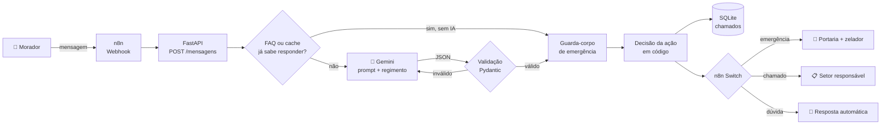
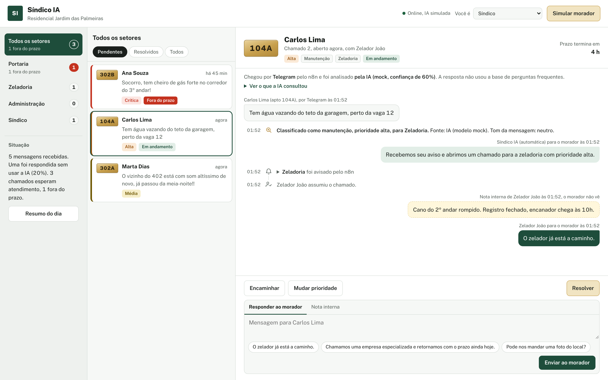
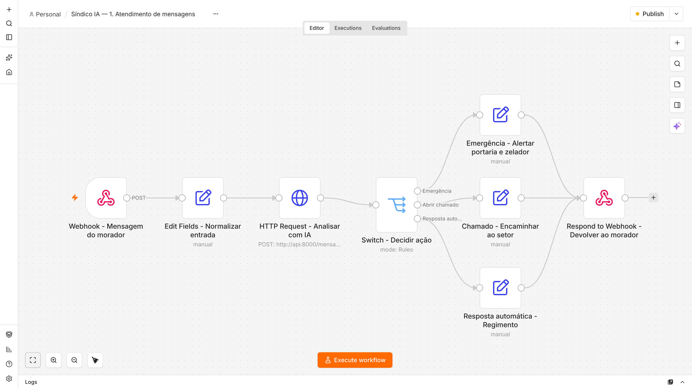
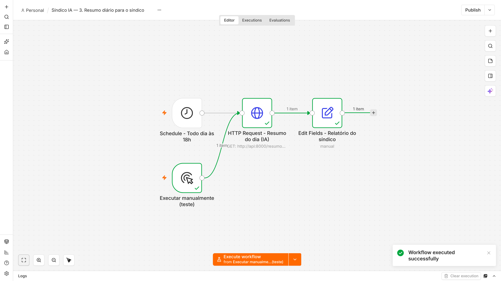
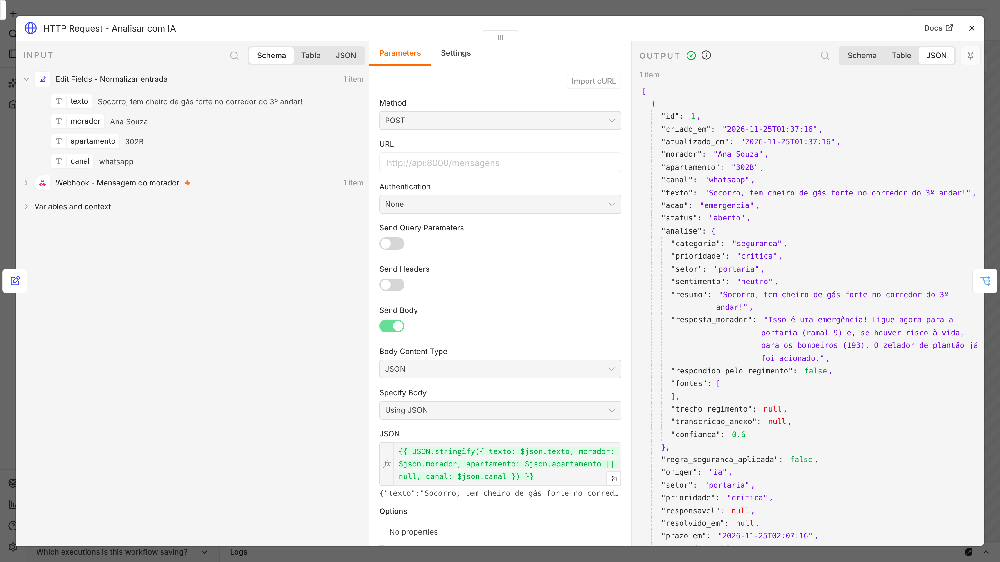
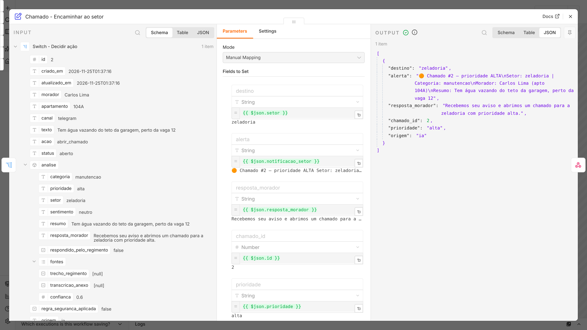
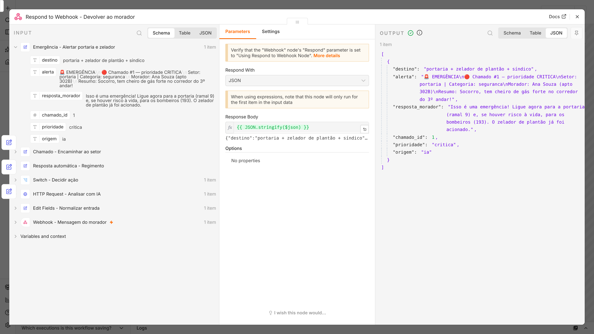
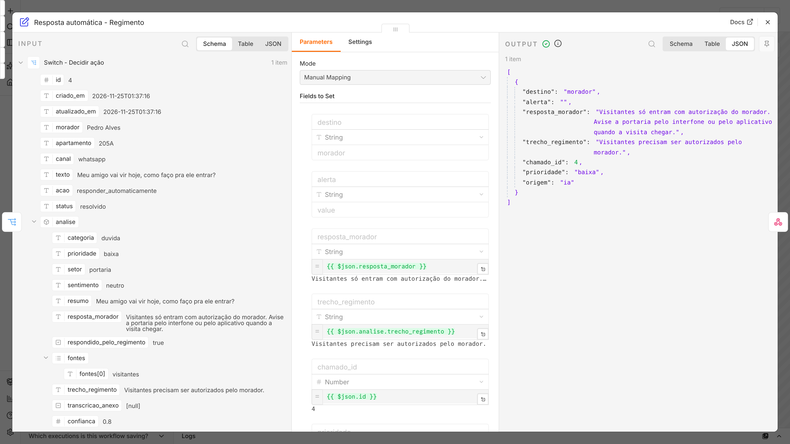
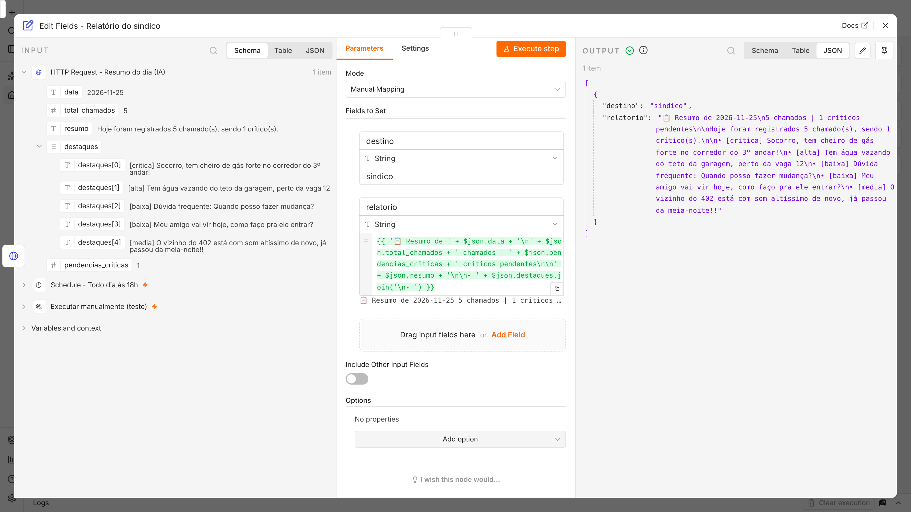
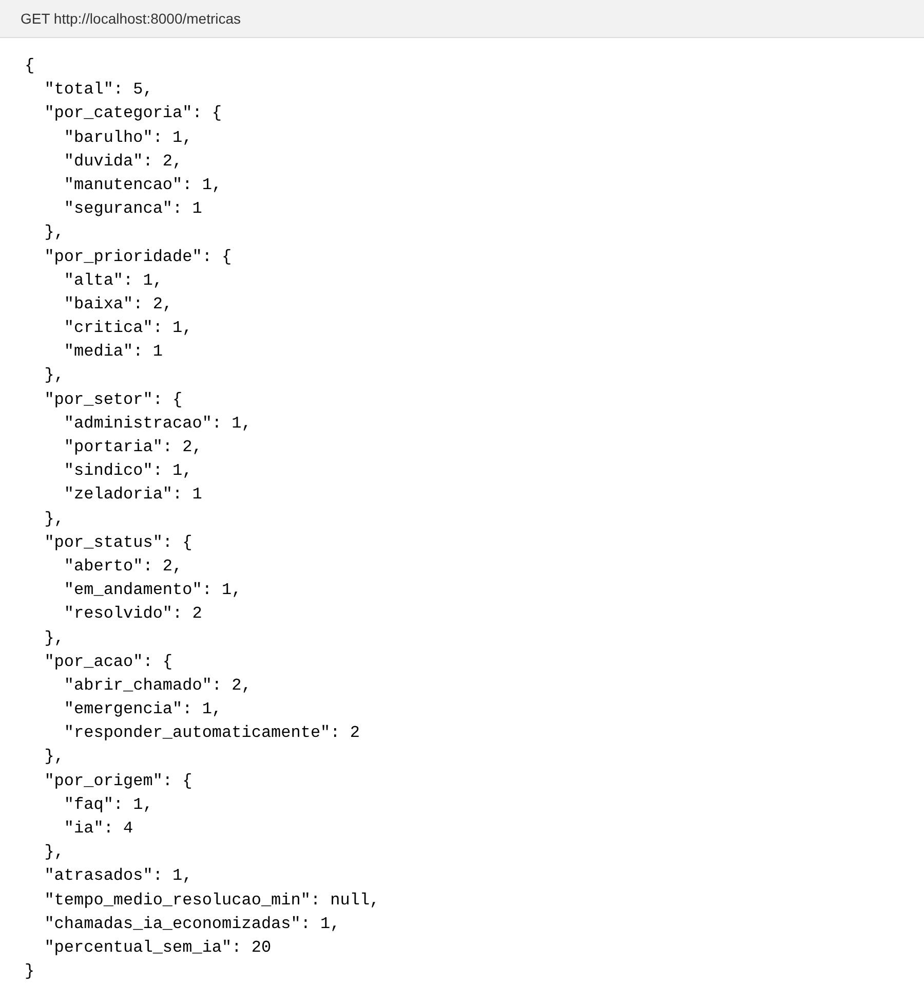

# 🏢 Síndico IA

> Central inteligente de atendimento para condomínios. Ela **entende** a mensagem do morador, **classifica**, **prioriza**, **responde dúvidas consultando o regimento interno**, **escala emergências** e entrega ao síndico um **resumo diário**, tudo com IA, uma API em FastAPI e automação no n8n.

Desafio Técnico KODIE: IA e Automação.

---

## 1. Apresentação da Ideia

<!-- ✏️ Personalize este parágrafo com a sua história -->
Em quase todo condomínio, a comunicação com a administração acontece por grupos de WhatsApp e mensagens soltas para o síndico e o zelador. Avisos urgentes, como um vazamento, se perdem no meio de perguntas repetidas ("a piscina abre segunda?", "posso fazer mudança domingo?"). O síndico, que muitas vezes é um morador voluntário, gasta horas lendo e encaminhando mensagens, e as emergências demoram para chegar a quem pode resolvê-las.

A ideia do **Síndico IA** surgiu dessa realidade: em vez de uma empresa genérica, um cenário concreto em que classificar e priorizar mensagens faz diferença de verdade, inclusive para a segurança dos moradores.

## 2. Problema Escolhido

O projeto tem como base o **caso 4.1 — Classificação de Mensagens** e o amplia com elementos dos outros três casos:

| Caso do desafio | Como aparece no Síndico IA |
|---|---|
| **4.1 Classificação** | Toda mensagem recebe categoria, setor responsável e sentimento |
| **4.3 Organização de tarefas** | Cada mensagem vira um chamado com prioridade (baixa → crítica) e status |
| **4.4 Perguntas frequentes** | Dúvidas respondidas automaticamente com base no **regimento interno** |
| **4.2 Resumo automático** | Todo dia às 18h a IA gera um resumo dos chamados para o síndico |

## 3. Solução Proposta



**Como a IA participa:**
1. **Interpreta** a mensagem em linguagem natural, mesmo informal ("tá saindo água do teto da garagem!!").
2. **Classifica** em categoria, prioridade, setor e sentimento, sempre em **JSON estruturado**.
3. **Responde** dúvidas consultando o regimento que vai no prompt e informa qual trecho usou.
4. **Resume** os chamados do dia para o síndico.
5. *(Opcional)* **Transcreve áudios e descreve fotos** enviados pelo morador, porque o Gemini é multimodal.

**Decisões de projeto (o que vai além do básico):**
- **A IA interpreta, o código decide.** A ação final (emergência, chamado ou resposta automática) é definida por regras em `app/servico.py`, de forma previsível e testável.
- **Guarda-corpo de segurança.** Se a mensagem contém termos como "cheiro de gás" ou "preso no elevador", a prioridade é forçada para **crítica**, mesmo que a IA erre.
- **Validação com nova tentativa automática.** Todo JSON da IA passa pelo Pydantic. Se vier inválido, o erro é devolvido à IA, que tenta de novo (até 3 vezes).
- **Respostas fundamentadas.** O prompt proíbe inventar regras. A IA só responde com o que está no regimento e indica o trecho usado.
- **Proteção contra prompt injection.** A mensagem do morador vai delimitada por `<mensagem>`, e a IA é instruída a ignorar ordens escritas ali dentro.
- **Economia de IA (FAQ + cache).** Antes de chamar o modelo, a API tenta responder sozinha:
  1. **FAQ local** (`data/faq.json`): as 12 dúvidas mais comuns (piscina, mudança, boleto…) são reconhecidas por palavras-chave e respondidas na hora.
  2. **Cache:** se uma pergunta já foi respondida pela IA nos últimos 7 dias, a mesma resposta é reaproveitada.

  Reclamações ("meu boleto veio **errado**"), mensagens que citam vizinhos, textos longos e **qualquer emergência** sempre vão para a IA. Problemas específicos de um morador (como um vazamento) nunca entram no cache. Cada resposta informa a `origem` (`faq`, `cache` ou `ia`), e `/metricas` mostra quantas chamadas de IA foram economizadas.
- **Resistência a instabilidade.** Se o Gemini estiver sobrecarregado (429/503) ou lento, a API tenta de novo e pode usar modelos reserva (`GEMINI_MODELOS_RESERVA`).
- **Escalonamento.** Um fluxo do n8n verifica a cada 10 minutos se algum chamado crítico está parado há mais de 30 minutos e alerta o síndico.

## 4. Tecnologias Utilizadas

| Camada | Tecnologia |
|---|---|
| IA | **Google Gemini** (API REST, saída em JSON); provedor `mock` para testes offline |
| Back-end | **Python 3.12 + FastAPI** |
| Validação | **Pydantic v2** |
| Banco de dados | **SQLite** |
| Automação | **n8n** (3 fluxos) |
| Front-end | **HTML, CSS e JavaScript puros**, servidos pelo FastAPI |
| Infraestrutura | **Docker + Docker Compose** |
| Testes | **pytest** |

## 5. Funcionamento do Sistema

### 5.1 Como a API recebe os dados
O n8n recebe a mensagem no webhook e faz um `POST /mensagens`:

```json
{
  "texto": "Tem água vazando do teto da garagem, perto da vaga 12",
  "morador": "Carlos Lima",
  "apartamento": "104A",
  "canal": "telegram"
}
```

### 5.2 Como a IA processa
A API monta o prompt (`app/prompts.py`) com as **regras de classificação**, o **regimento** e a mensagem, e chama o Gemini pedindo `application/json`. A resposta é validada contra o modelo `AnaliseIA`:

```json
{
  "id": 2,
  "acao": "abrir_chamado",
  "status": "aberto",
  "prioridade": "alta",
  "setor": "zeladoria",
  "categoria": "manutencao",
  "analise": {
    "categoria": "manutencao",
    "prioridade": "alta",
    "setor": "zeladoria",
    "sentimento": "neutro",
    "resumo": "Vazamento de água no teto da garagem, próximo à vaga 12.",
    "resposta_morador": "Obrigado pelo aviso, Carlos! Abrimos um chamado com prioridade alta para a zeladoria.",
    "respondido_pelo_regimento": false,
    "trecho_regimento": null,
    "transcricao_anexo": null,
    "confianca": 0.93
  },
  "resposta_morador": "Obrigado pelo aviso, Carlos! ...",
  "notificacao_setor": "🟠 Chamado #2 — prioridade ALTA\nSetor: zeladoria | ..."
}
```

### 5.3 Como a automação é executada

| Fluxo n8n | Gatilho | O que faz |
|---|---|---|
| `1-atendimento.json` | Webhook `POST /webhook/sindico` | Normaliza a entrada → chama a API → **Switch** pela ação → monta o alerta do setor → responde ao morador |
| `2-escalonamento.json` | A cada 10 min (ou manual) | Busca chamados críticos abertos há mais de 30 min → alerta o síndico |
| `3-resumo-diario.json` | Todo dia às 18h (ou manual) | Pede à IA o resumo do dia → monta o relatório do síndico |

### 5.4 Painel web

Em **http://localhost:8000** fica o painel do Síndico IA, servido pela própria API. Não precisa de build nem de outro servidor.

| Área | O que faz |
|---|---|
| **Mensagem do morador** | Simula o morador. Envia **pelo webhook do n8n** (fluxo completo) ou direto na API, e mostra a ação, a prioridade, o setor, a origem (FAQ/cache/IA), a resposta ao morador, o trecho do regimento e o tempo de resposta |
| **Métricas** | Total de chamados, críticos abertos, chamados em aberto e o **percentual respondido sem IA** |
| **Chamados** | Lista em tempo real (atualiza a cada 8 s), com filtros por status e prioridade e botões **Assumir** e **Resolver** |
| **Resumo do dia** | Gera com IA o mesmo relatório que o n8n envia ao síndico às 18h |

Tem tema claro e escuro (segue o sistema) e funciona no celular.



### 5.5 Endpoints da API

| Método | Rota | Descrição |
|---|---|---|
| `GET` | `/health` | Status, provedor de IA e versão do prompt |
| `POST` | `/mensagens` | Analisa uma mensagem e cria o chamado |
| `GET` | `/chamados` | Lista chamados (filtros: `status`, `prioridade`) |
| `GET` | `/chamados/{id}` | Detalhe de um chamado |
| `PATCH` | `/chamados/{id}` | Atualiza o status (`aberto`, `em_andamento`, `resolvido`) |
| `GET` | `/chamados/criticos-parados?minutos=30` | Usado no escalonamento |
| `GET` | `/resumo-diario` | Resumo do dia gerado pela IA |
| `GET` | `/metricas` | Contagem por categoria, prioridade, setor, status, ação e origem, além das chamadas de IA economizadas |

A documentação interativa fica em **http://localhost:8000/docs**.

## 6. Como Executar

### Pré-requisitos
- Docker e Docker Compose (**recomendado**), **ou** Python 3.11+ e n8n
- Uma chave gratuita do Gemini: https://aistudio.google.com/apikey

### Opção A — Docker Compose (API + n8n)

```bash
git clone <url-do-seu-repositorio>
cd sindico-ia
cp .env.example .env          # edite e coloque sua GEMINI_API_KEY
docker compose up -d --build
```

- **Painel:** http://localhost:8000
- API (Swagger): http://localhost:8000/docs
- n8n: http://localhost:5678 (crie sua conta local no primeiro acesso)

**Importar os fluxos no n8n:**

```bash
docker compose exec n8n n8n import:workflow --separate --input=/workflows
```

Ou importe pela interface: **Workflows → Import from File** → selecione os arquivos da pasta `n8n/`. Depois, abra o fluxo **1. Atendimento** e **ative/publique** o fluxo.

**Testar:**

```bash
./exemplos/testar.sh            # envia as mensagens de exemplo pelo n8n
ALVO=api ./exemplos/testar.sh   # envia direto para a API
```

### Opção B — Sem Docker

```bash
python -m venv venv && source venv/bin/activate   # Windows: venv\Scripts\activate
pip install -r requirements.txt
cp .env.example .env    # coloque a chave e troque DATABASE_PATH para ./sindico.db
export $(grep -v '^#' .env | xargs)               # Windows: defina as variáveis manualmente
uvicorn app.main:app --reload
```

Em outro terminal, rode o n8n com `npx n8n`, importe os fluxos e **troque a URL `http://api:8000` por `http://localhost:8000`** nos nodes HTTP Request.

### Testes automatizados

```bash
pytest -q
```

Os testes usam o provedor `mock` e não gastam a cota da IA. Eles cobrem: emergência, resposta pelo regimento, abertura de chamado, guarda-corpo de segurança, nova tentativa com JSON inválido, sobrecarga do Gemini e modelo reserva, FAQ, cache, escalonamento, resumo e métricas.

### Sem chave de IA?
Defina `AI_PROVIDER=mock` no `.env`. O sistema passa a funcionar com regras por palavra-chave, o que é útil para testar o fluxo do n8n.

---

## 7. Documentação do Fluxo de Automação

> As imagens ficam em `docs/prints/`. O roteiro do que capturar está em [`docs/ROTEIRO-PRINTS.md`](docs/ROTEIRO-PRINTS.md).

### 7.1 Fluxo completo

*Os 8 nodes do fluxo principal: o webhook recebe a mensagem, a API analisa com IA e o Switch distribui em 3 caminhos.*




### 7.2 Execução bem-sucedida

*Execução concluída de uma mensagem de emergência, com todos os nodes em verde.*

### 7.3 Configuração dos nodes

| Node | Função | Print |
|---|---|---|
| Webhook - Mensagem do morador | Recebe `POST /webhook/sindico` e responde via node "Respond to Webhook" |  |
| Edit Fields - Normalizar entrada | Extrai `texto`, `morador`, `apartamento` e `canal` do body e preenche os valores padrão |  |
| HTTP Request - Analisar com IA | `POST http://api:8000/mensagens` com o JSON normalizado |  |
| Switch - Decidir ação | 3 regras sobre `{{$json.acao}}`: emergência, chamado ou resposta automática |  |
| Emergência / Chamado / Resposta | Monta o destino, o alerta para o setor e a resposta ao morador |  |
| Respond to Webhook | Devolve o JSON final para quem enviou a mensagem |  |

### 7.4 Resultados
| Cenário | Print |
|---|---|
| 🔴 Emergência ("cheiro de gás") |  |
| 🟠 Chamado ("vazamento na garagem") |  |
| 💬 Resposta pelo regimento ("mudança no domingo") |  |
| 📋 Resumo diário |  |
| 📊 Métricas e economia de IA |  |

---

## 📁 Estrutura do Projeto

```
sindico-ia/
├── app/
│   ├── main.py          # Rotas FastAPI
│   ├── servico.py       # Regras de negócio: FAQ/cache, guarda-corpo e decisão da ação
│   ├── faq.py           # Respostas sem IA: perguntas frequentes e cache
│   ├── ai.py            # Integração com o Gemini, validação e novas tentativas, provedor mock
│   ├── prompts.py       # Prompts estruturados (versionados)
│   ├── schemas.py       # Modelos Pydantic (entrada, análise da IA, chamado)
│   ├── db.py            # Persistência em SQLite
│   ├── static/          # Painel web (HTML, CSS e JS puros)
│   └── config.py        # Variáveis de ambiente
├── data/regimento.md    # Base de conhecimento usada pela IA
├── data/faq.json        # Perguntas frequentes respondidas sem IA
├── n8n/                 # Fluxos exportados (JSON)
├── exemplos/            # Mensagens de exemplo + script de teste
├── docs/prints/         # Capturas de tela do n8n
├── tests/               # Testes automatizados (pytest)
├── Dockerfile
├── docker-compose.yml
├── .env.example
└── requirements.txt
```

## 🚀 Próximos passos
- Integrar o **Telegram** (node *Telegram Trigger* + *Telegram* do n8n) como canal real para moradores e zelador, com botões "Assumir" e "Resolvido" que chamam `PATCH /chamados/{id}`.
- Busca semântica (embeddings) no regimento quando ele for grande demais para ir inteiro no prompt.

## 🔒 Segurança
Nenhuma chave é versionada. Use o `.env` (que está no `.gitignore`) a partir do `.env.example`.
